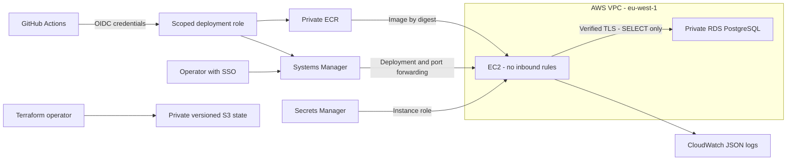

# NovaPay Sample Platform

A small .NET 10 wallet API demonstrating secure delivery to AWS. Wallet data is synthetic; balances use integer kobo (`125000` kobo = ₦1,250). No real  customer records, or card data are used.

## What is working that I did

- **Real AWS staging:** EC2, private RDS PostgreSQL, ECR, Secrets Manager, SSM, and remote Terraform state in `eu-west-1`.
- **CI/CD:** checks and scans before publishing an image and deploying it through GitHub OIDC and SSM.
- **Restricted runtime:** non-root container, read-only filesystem, limited resources, and a read-only database user.
- **Application logs:** JSON events delivered to CloudWatch with 30-day retention.
- **Local monitoring:** optional Prometheus Compose service and tested alert rules. This is not deployed on AWS and does not send notifications.

Staging is private: there is no public API URL or SSH port. Live deployment, endpoint checks, database TLS/write-denial checks, and CloudWatch delivery have been verified. This is an assessment environment, not a production-ready or certified-compliant payment system.

## Architecture



The API listens on EC2 loopback port 8080. The host retrieves the application password and mounts it read-only; the API receives no AWS credentials. Public-subnet outbound access avoids a NAT gateway, but does not permit inbound access. EC2 and RDS are single-instance staging resources.

## Run locally

Requires Docker with the Compose plugin and OpenSSL. Run these commands in Linux/WSL from the repository root. Keep passwords outside the repository:

```bash
export NOVAPAY_SECRETS_DIR="$HOME/.local/share/novapay/secrets"
install -d -m 700 "$NOVAPAY_SECRETS_DIR"
for name in admin-password app-password; do
  if [ ! -e "$NOVAPAY_SECRETS_DIR/$name" ]; then
    (umask 077; openssl rand -hex 32 > "$NOVAPAY_SECRETS_DIR/$name")
    chmod 444 "$NOVAPAY_SECRETS_DIR/$name"
  fi
done
docker compose up --build -d
curl http://localhost:8080/ready
curl http://localhost:8080/wallets/demo-wallet
```

The private parent directory protects the files; read-only secret mounts let non-root containers read them. These are local file-backed secrets, not a managed vault. PostgreSQL has no published host port. Local database TLS is disabled on the Compose network; staging requires verified TLS.

Stop with `docker compose down`. **Do not add `-v` unless you intend to delete the database.** Initialization runs only for a new database volume. Editing a password file does not change an existing PostgreSQL password.

Optional monitoring:

```bash
docker compose -f compose.yaml -f compose.monitoring.yaml up -d --build
```

Open `http://localhost:9090` and check Targets and Alerts. See [monitoring instructions](docs/observability.md). The development WSL environment lacked the Compose plugin: direct Docker integration and monitoring tests passed, but Compose startup itself remains to be verified.

| Endpoint | Purpose |
|---|---|
| `/health` | Process is running |
| `/ready` | Database/table access works; returns 503 on failure |
| `/version` | Deployed commit SHA |
| `/wallets/demo-wallet` | Synthetic balance |
| `/metrics` | Prometheus request counts by route template and status |

## Pipeline and local checks

The [workflow](.github/workflows/ci.yml) runs on pull requests, main/master pushes, and manual runs. Quality and secret/dependency jobs run in parallel; both must pass before the container job.

| Stage | What it checks |
|---|---|
| Quality | Locked restore, formatting, unit/API tests, Prometheus rules, C# security analyzers |
| Security | Gitleaks scans fetched Git history; Trivy scans dependency lockfiles |
| Container | Multi-stage build, image scan, actual process UID/runtime restrictions, PostgreSQL integration, deployment/rollback tests |
| Deploy | Master push/manual runs only: obtain OIDC credentials, push the same checked image, deploy its digest through SSM |

Trivy fails on **HIGH or CRITICAL** vulnerabilities, including unfixed findings. Gitleaks fails on detected secrets. Scan errors also fail the job; summaries do not override failures. `CI passed` succeeds only if all required jobs succeed. GitHub retains test/scan artifacts for 14 days.

The deployment checks a candidate before switching the active container, then checks readiness again. A failed replacement attempts rollback. Switching has brief downtime, and the first deployment has no previous release to restore. See [deployment details](docs/deployment-workflow.md).

To run the main checks locally, install .NET 10 SDK, Docker, Python 3, and jq. Use Linux/WSL for the shell-based deployment tests:

```bash
dotnet restore NovaPay.slnx --locked-mode
dotnet format NovaPay.slnx --no-restore --verify-no-changes
dotnet test NovaPay.slnx --configuration Release --no-restore
dotnet build NovaPay.slnx --configuration Release --no-restore --no-incremental -p:AnalysisModeSecurity=All -p:TreatWarningsAsErrors=true
docker build -t novapay-wallet:local .
python3 scripts/verify_container.py novapay-wallet:local
python3 scripts/test_deployment.py
```

The integration script creates temporary resources and cleans up its own containers, network, volume, and generated secrets. It checks the actual process UID **1654**, read-only filesystem, dropped capabilities, database behavior, and identifier-free JSON logs/metrics. Rollback tests use mocks; they are not a live recovery drill.

Run the exact Gitleaks, Trivy, and Prometheus commands shown in the workflow with the pinned tool versions to reproduce those gates. AWS publishing/deployment steps require the configured cloud identities and are not an offline local test.

## Terraform and staging access

Requires Terraform 1.12+, AWS CLI v2, an authorized SSO profile, and the Session Manager plugin for tunnels. For the **existing assessment account/backend**:

```powershell
aws sso login --profile novapay
aws sts get-caller-identity --profile novapay
$env:AWS_PROFILE = 'novapay'
$env:TF_VAR_aws_account_id = '008971632699'
terraform '-chdir=infra/staging' init
terraform '-chdir=infra/staging' validate
terraform '-chdir=infra/staging' plan '-out=staging.tfplan'
# Review the plan before applying it.
terraform '-chdir=infra/staging' apply staging.tfplan
```

The separate [bootstrap stack](infra/bootstrap/README.md) owns the S3 backend. It was created first and its initial local state migrated to S3. A fresh checkout now uses that existing bucket. For another AWS account, adapt the backend/account guards, bucket name, GitHub trust, and workflow resource identifiers before provisioning; this repository is not account-agnostic.

Terraform creates the application secret resource, not its value. On a new deployment, initialize the database and credential with the [operator bootstrap tool](tools/NovaPay.DatabaseBootstrap/README.md) before deploying the API. It is not an automatic rotation or schema-migration service.

Open an API tunnel in PowerShell and leave it running:

```powershell
aws ssm start-session --target i-0f497102e8d5a3051 --document-name AWS-StartPortForwardingSession --parameters "portNumber=8080,localPortNumber=18080" --profile novapay --region eu-west-1
```

From another terminal, run `Invoke-RestMethod http://localhost:18080/ready` or open `http://localhost:18080/wallets/demo-wallet`. Press Ctrl+C in the tunnel terminal when finished.

View application logs:

```powershell
aws logs tail /novapay/staging/wallet --since 15m --format short --profile novapay --region eu-west-1
```

Resources incur AWS charges, including EC2, RDS, storage, public IPv4, logs, and Secrets Manager; credits do not make them inherently free. RDS deletion protection/final snapshots and backend protections require deliberate teardown. Keep state until cleanup is complete.

## Why some IAM policies contain wildcards

The application and GitHub roles do not have administrator permissions. These explicit exceptions are present in the Terraform:

| Wildcard | Reason and boundary |
|---|---|
| `Resource: "*"` for `ecr:GetAuthorizationToken` | ECR login does not support repository-scoped resource permissions. Push/pull operations are restricted to the wallet repository. |
| `Resource: "*"` for `ssm:UpdateInstanceInformation` and the four `ssmmessages` channel actions | Required agent/channel operations use these unscoped resources. They do not grant arbitrary command execution. |
| `Resource: "*"` for `ssm:GetCommandInvocation` | Command-result lookup does not support resource scoping. `SendCommand` is separately restricted to the deployment document and EC2 instance. |
| `:log-stream:*` for CloudWatch writes | Release streams have dynamic names. Create/write permission is restricted to `/novapay/staging/wallet`; no log-read/delete or group-creation permission is granted to EC2. |
| S3 bucket-policy `s3:*`, `Principal: "*"`, and `bucket/*` | An explicit **Deny** blocks insecure transport for every caller and operation on that state bucket and its objects. It grants no access. |

The bootstrap stack also defines an unattached, narrowly scoped staging-state operator policy. The current human SSO administrator is still broadly privileged; that policy does not reduce administrator access.

## Security, data location, and remaining gaps

All wallet data is synthetic. AWS staging data and application logs are in Ireland (`eu-west-1`). Real Nigerian financial data would require a documented cross-border/data-location assessment covering applicable NDPA, institutional, outsourcing, and contractual obligations. This is not approval to host real bank data abroad.

There is no real card processing in the demo for something like PCI DSS as scope it depends on actual card-data flows and systems affecting security; AWS hosting and passing scans do not establish compliance.

Current gaps are explicit:

- No end-user authentication or wallet ownership checks; keep access restricted.
- No automated app-password rotation. For a leak, contain access, terminate sessions, rotate PostgreSQL and Secrets Manager together, and recreate containers. See the runbook.
- PostgreSQL log export is not complete SQL-read auditing; there is no repository-managed durable CloudTrail trail or immutable evidence archive.
- CloudWatch's bounded non-blocking log buffer can lose events during outages; 30-day retention is a staging choice.
- No persistent AWS metrics collector, delivered alerts, completed restore drill, automated drift detection, or high availability.
- Several Actions/base-image tags remain mutable; branch protection and account-wide MFA enforcement need separate verification.

## Review documents

- [Threat model](THREAT_MODEL.md): assets, boundaries, threats, controls, and gaps.
- [Incident runbook](RUNBOOK.md): suspected unauthorized database access and recovery.
- [AI usage](AI_USAGE.md): actual prompts, corrections, and honest attribution of findings.
- [CloudWatch logging](docs/cloudwatch-logging.md), [monitoring](docs/observability.md), and [deployment](docs/deployment-workflow.md): operational details.
