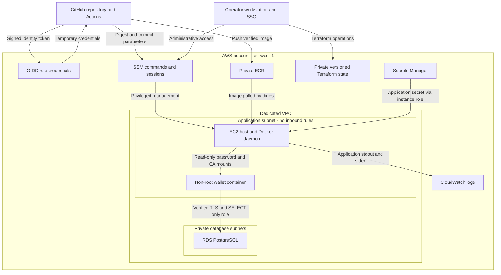

# NovaPay staging threat model

 This covers the wallet API, GitHub deployment pipeline, AWS staging infrastructure, and operator access. This is a synthetic assessment deployment, not a production banking platform or compliance certification.

## Scope and assumptions

- Wallet records are synthetic. No real customer, BVN/NIN, or settlement data belongs here.
- The API reads balances from private RDS PostgreSQL; amounts are integer kobo.
- No public application ingress or SSH is enabled. Operators access the loopback-bound API through authenticated SSM sessions.
- The API has no end-user authentication or wallet-ownership checks. Restricted infrastructure access is the current boundary, not a replacement for production application authorization.
- EC2 and RDS are single-instance staging resources in eu-west-1. High availability is not implemented.
- Branch protection, mandatory reviews, account-wide MFA enforcement, and external security tools have not been verified by this model and are not assumed.

## Assets to protect

| Asset | Why it matters |
|---|---|
| Wallet data and schema | Protect financial integrity and, with real data, customer confidentiality. |
| Application and administrator credentials | Prevent unauthorized reads and privileged database changes. |
| Source, workflow, and container image | Prevent attacker-controlled code from reaching staging. |
| AWS identities and Terraform state | Prevent unauthorized infrastructure or permission changes. |
| Logs and backups | Preserve evidence and support recovery. |
| API availability | Keep wallet access working despite faults or abuse. |

## Data flow and trust boundaries

The main boundaries separate PR code from deployment credentials, GitHub from AWS, the privileged host from the application container, the application subnet from RDS, and runtime identities from infrastructure administration. SSM remains a powerful management path even without an open inbound port.

## Threats and controls

STRIDE categories are included to organize the review. Priorities are qualitative judgments for this deployment, not measured risk scores.

| Threat | STRIDE category | Implemented protection | Remaining risk / action |
|---|---|---|---|
| Another repository or PR assumes our deployment identity | Spoofing | OIDC trust matches immutable owner/repository IDs, master branch, and STS audience. Deployment is limited to master push/manual runs. | Trust is not restricted to a particular workflow file. Verify branch protection, reviews, and GitHub account security. |
| An attacker uses an operator identity or SSM tunnel | Spoofing / elevation of privilege | SSO and SSM avoid persistent SSH keys and public management ports. | The current operator permission set is administrative. Narrow routine access and verify MFA/session controls. |
| Malicious source, Action, or dependency reaches staging | Tampering | Locked restore, tests, SAST, vulnerability and secret gates; the scanned image is pushed and deployed by digest; ECR tags are immutable. | Scans do not prove trustworthiness. Several Action/base-image references use mutable version tags. Review changes and pin reviewed dependencies where appropriate. |
| GitHub invokes arbitrary host commands | Elevation of privilege | Deployment role can invoke only the fixed SSM document on one instance. Inputs are constrained digest/SHA values delivered as environment variables. | The role can still deploy a malicious application image. Protect repository changes; container isolation is not absolute. |
| A compromised API changes balances or injects SQL | Tampering / elevation of privilege | Parameterized query, identifier validation, SELECT-only DB role, and tested write denial. | Read-only access can still expose all accessible records. Review grants, memberships, and application authorization. |
| A caller reads another person's wallet | Information disclosure | Private SSM-controlled access and synthetic data. | No per-user or per-wallet authorization. This blocks public real-data use; HTTPS alone cannot fix it. |
| A container steals host credentials or escapes | Elevation of privilege | Non-root UID, read-only root filesystem, dropped capabilities, no-new-privileges, limits, no Docker socket mount; host IMDSv2 with hop limit 1. | Shared kernel/daemon vulnerabilities and host-admin access remain. These controls are not a guarantee; patch and rebuild compromised hosts. |
| Credentials leak through Git, logs, or retained releases | Information disclosure | Secret scan gate, runtime retrieval, no secret values supplied to Terraform, private release directories, read-only mounts, temporary registry-auth cleanup. | The app can read its password and old releases retain theirs. Automatic rotation is absent; revoke leaked credentials and retire old releases after preserving evidence. |
| An attacker intercepts DB traffic | Information disclosure / tampering | RDS requires TLS; client validates certificate and hostname. DB ingress is restricted to the application security group. | Valid credentials or a compromised host can abuse legitimate encrypted sessions. |
| Privileged access alters infrastructure/state | Tampering / elevation of privilege | Private encrypted, versioned S3 backend, HTTPS-only policy, state locking, account guard; runtime/deployment roles have no state permissions. | Administrator access remains powerful; versioning is not immutable storage. Review permissions and add drift detection. |
| An attacker denies actions or removes evidence | Repudiation | Git/workflow/SSM identifiers, CloudTrail management-event history, JSON logs and per-release CloudWatch streams. | No comprehensive SQL-read audit, durable repository-managed CloudTrail trail, or immutable archive. Retention and buffering can lose evidence. |
| API, DB, disk, or dependency failure causes an outage | Denial of service | Container limits, readiness checks, candidate verification, rollback, bounded logs, local alert rules, and configured RDS backups. | Single EC2 and single-AZ RDS; no persistent AWS metrics collector or delivered alerts; no completed restore drill. |
| A compromised host sends data to an external HTTPS endpoint | Information disclosure | No public inbound application access; RDS has private routes. | Host HTTPS egress permits any destination for AWS APIs and downloads. It is not destination allowlisting; consider private endpoints and tighter egress for production. |

## Deliberate staging trade-offs

- **Private access:** demonstrate AWS through SSM; reviewers can also run Compose locally. A public URL is not required by the brief.
- **Synthetic data:** avoids real customer processing in this exercise. Operational metadata and logs still need access controls.
- **Single-host deployment:** reduces cost and complexity but has brief switching downtime and no host-level failover.
- **30-day application retention:** a staging choice, not a regulatory retention claim. Non-blocking logging can lose events during prolonged outages.
- **Ireland hosting:** regional data and application logs are outside Nigeria. Production use needs a documented data-location/transfer assessment, covering backups and service providers as well as the database.

## Highest-priority gaps

1. Before public or real-data use: authenticate users, enforce wallet ownership, use a reviewed HTTPS entry point, and control abuse.
2. Before operational-readiness claims: deliver alerts, independently probe readiness, and rehearse backup restoration and secret rotation in a disposable environment.
3. Before audit-coverage claims: define PostgreSQL audit events/retention, durable CloudTrail collection, evidence permissions, and deletion protection.
4. Before expanding deployment trust: verify reviews/branch protection, reduce routine operator privilege, review third-party Actions, and add drift detection.

Adding card processing, real KYC data, transfers, lending, public ingress, or new services changes this model. PCI DSS applicability depends on actual card-data flows and systems that can affect their security. This model makes no certification or blanket out-of-scope claim.

## Evidence and review

Evidence includes CI gates, container non-root/restriction checks, live DB TLS/write-denial checks, deployment/rollback tests, live readiness checks, native Prometheus tests, and verified CloudWatch JSON events. Mocked rollback tests are not a live disaster-recovery drill. Local alert evaluation is not notification delivery.
